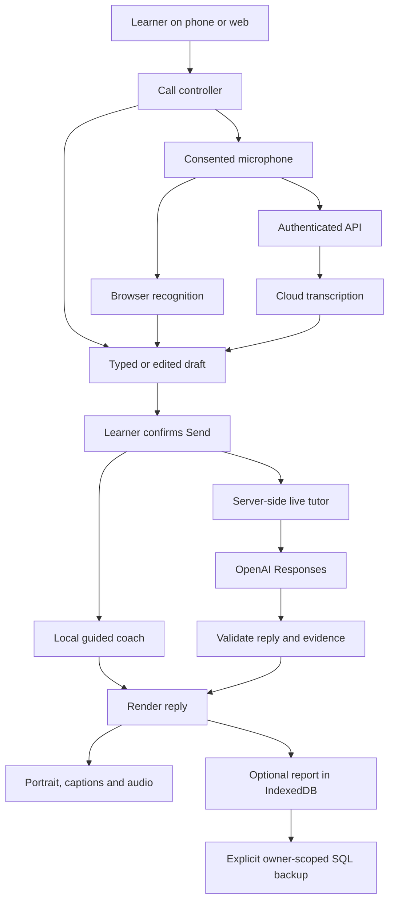

# SpeakBuddy | Engineering design

## Implemented architecture

One portable JavaScript API runs on Node locally and as a hosted Worker. The browser owns the active conversation. Keeping guided turns and the default journal local makes the basic loop inexpensive and usable when a speech service is unavailable.



**Timing and ownership.** Guided input can use the browser's `SpeechRecognition` or typed text. In live mode, `MediaRecorder` captures one bounded turn. The user stops recording, the server transcribes its bytes and the learner edits and confirms the draft. The tutor cannot answer interim microphone results. Tutor audio is cancelled when input starts. Turning away from the call releases capture resources; closing a live turn aborts the request. A transcript for this session stays in browser memory. Standard hosting and device services can have their own logs.

**Rendering.** Each fictional tutor has three matched original portrait frames. A blink timer and subtle nod animate idle moments; mouth movement follows the tutor’s playback state. An installed voice reads complete turns, including user-specific recasts. The bundled Flite studio voice plays full prepared openers or the matched follow-up when a local English voice is unavailable. The UI identifies partial playback. The fallback is US English. OS and in-app reduced motion both apply. A future renderer can consume provider viseme timestamps against the audio clock. See [voice provenance](VOICE-NOTICES.md).

## Stack and evolution

| Layer | Low-cost MVP in this repository | Production choice and reason |
|---|---|---|
| Client | Responsive browser ES modules, accessible HTML controls, CSS iPhone frame. Zero build dependencies for local practice. | Expo/React Native with TypeScript for native screens and audio lifecycle; retain a web entry point. Shared catalog, turn types and report rules can move across platforms. |
| API and auth | Native Node HTTP with SQLite and a random HttpOnly device cookie for loopback development. Hosted Worker trusts the platform-supplied per-site identity. Local requests cannot supply a hosted identity. | Managed OIDC with rotating short-lived tokens, authenticated tenant scope, API service in a low-latency region, Postgres row-level ownership and deletion. Use a shared API for web and native. |
| Turn transport | Half-duplex HTTP requests, 20-second upstream timeout, 35-second microphone cap and 2 MiB audio cap. Voice and captions are independently available. | WebRTC media with LiveKit or equivalent, short-lived room tokens, TURN, server VAD and interruption cancellation. Separate reliable control messages for confirmed utterances and turn IDs. |
| STT and code switching | Browser recognition in guided sessions where supported. OpenAI `gpt-transcribe` for consented live recordings. Editable transcript; no permanent raw recordings. | Stream partials and locale/keyword hints. Evaluate Hindi/Kannada/Tamil mixed turns independently on realistic phone audio. Offer push-to-talk in noise. |
| Conversation | Three active instructions from `src/prompts.js`, eight recent messages and up to three repeated pattern tags. `gpt-6-luna` with strict JSON schema, `store:false` and bounded output. Guided fallback is a deliberate learner choice. | Versioned prompts, structured-output evaluation, multilingual moderation, request IDs and tiered models only if cost and teacher review warrant them. |
| Voice and avatar | Local `speechSynthesis` English voice or bundled studio prompt audio; playback-speed control. Three portrait frames per tutor. | Stream TTS with word/viseme timestamps. Test a licensed stock-face provider against an original rigged character before committing to per-minute billing. |
| Progress and memory | IndexedDB preferences and reports. User-initiated SQL backup. Per-session corrected snippets and vocabulary, self-rated comfort and next task. | PostgreSQL with migrations and scoped exercise history, background queues for post-session reports and purge. Add vector search only if curated and relational recall proves insufficient. |
| Monitoring | Unit, adapter and SQL integration checks. No transcript-level telemetry. | Consent-aware metrics for end-of-turn latency, ASR edit rate, corrective precision, error rates, cost per completed session and fallback share. Budget limits before parallel live learners. |

**Latency budget for the streaming trial.** Target p50 ≤1.5 s and p95 ≤3.5 s from committed learner turn to first tutor audio. Design budget: endpoint/network 150–350 ms, final STT 200–500 ms, model first phrase 250–750 ms, TTS first audio 150–350 ms and playback buffer 60–150 ms. Some stages can overlap; measure the total independently. The current HTTP path waits for complete transcription and model output. It has no measured production SLO.

**Graceful failure.** If a device lacks browser recognition, type or use configured live transcription. Reject oversized audio and malformed replies; remove model corrections unsupported by the supplied text. On upstream refusal, quota, timeout or offline network, keep the typed draft and offer guided practice. Learners can always end with an incomplete report. Physical Bluetooth interruption and Safari permission behaviour are pilot test cases.

## Database and retention

The executable SQLite/D1 DDL is [0000_speaking_studio.sql](../drizzle/0000_speaking_studio.sql). Local Node applies each numbered SQL migration transactionally and records its name. The production Postgres migration should map ISO timestamps to `timestamptz` and IDs to UUIDs where suitable. Below are the current logical records.

| Relation | Key and important columns | Purpose and policy |
|---|---|---|
| `users` | `id` PK, `created_at` | Opaque identity created on explicit report backup. No email or audio needed. |
| `tutor_profiles` | `id` PK, display name, age band, gender label, default accent | Public reference data. Accent, speed and voice overrides live in device preferences. |
| `sessions` | `id` PK, `user_id` FK, `tutor_id` FK, scenario, level, `ended_at`, seconds, total/spoken turns, engine | One immutable completed report; index on owner and end date. |
| `messages` | `id` PK, `session_id` FK, `turn_number`, role, excerpt; unique session/turn/role | Only evidence excerpts for saved corrections are backed up. Full transcripts are transient. |
| `mistakes` | `message_id` PK/FK, pattern, recast, explanation | One correction per learner turn. Count by pattern over sessions to find repeated issues. |
| `vocabulary` | Composite PK `(session_id, term)`, meaning, example | Terms introduced during each saved session. A vocabulary gap is a practice hypothesis, not a diagnosed deficiency. |
| `feedback` | `session_id` PK/FK, strength, next task, nullable self-rating 1–5, nullable pronunciation | Missing acoustic evidence stays null. Skipping confidence preserves null. |
| `progress` | SQL view grouped by user; sessions, turns, spoken turns, practice seconds, mean self-rating | Aggregates from canonical records. Weekly UI uses each learner’s local calendar. |
| `provider_usage` | Composite PK `(user_id, day, kind)`, counter | Atomically enforces daily caps independently of erasing learning records. |
| Browser `settings` and `reports` | Profile preference record and reports keyed by session UUID | Opt-in remembering or explicit Save. Local history is filtered on open; deletion is available in Settings. |

Foreign keys cascade from users to sessions, then to evidence, feedback and vocabulary. A D1 batch or SQLite transaction writes the complete report. A retry with the same UUID preserves the original immutable result. Another owner receives a conflict; user-supplied IDs never select someone else's results. Server expiry is currently applied when history/progress is accessed. Deploy a timed deletion job and a documented backup-expiry policy for a broader rollout.

## API contracts

Base path is `/api/v1`. Local device cookie is automatically issued. Hosted identity comes from the trusted site gateway. Public access to paid provider methods is outside the MVP. JSON responses use `Cache-Control: no-store`. The local app and API share an origin.

| Method and path | Who and payload | Result |
|---|---|---|
| `GET /config` | Anybody | `{live,sync}`. Exposes availability only. |
| `GET /catalog` | Anybody | Tutor descriptions, roles, goals, prompts and scenario metadata. |
| `POST /turns` | Identified adult live-mode client; JSON fields below; consent header | `{reply,correction,vocabulary,engine:"live"}`. Exact-span validation. No new database message. |
| `POST /transcriptions` | Identified adult live-mode client; raw WebM, MP4, Ogg or WAV bytes; matching MIME type, consent header | `{text}` draft. Browser offers only recordable formats. Maximum 2 MiB. |
| `PUT /sessions/{uuid}` | Identified owner; `{consent:true,report}` | 201 created, 200 already backed up by this owner, 409 on collision. Accepts positive-turn reports ended within 30 days. |
| `GET /sessions` | Identified owner | `{reports:[…]}`, newest first. Includes exact evidence snippets. |
| `GET /progress` | Identified owner | Counts, seconds, mean of voluntary ratings. Empty profile gives zero counts and null self-rating. |
| `DELETE /me` | Identified owner | Removes server learning records, including dependent evidence. Settings also clears the local journal. |

Live endpoints require `X-SpeakBuddy-Consent: adult-live-v1`. This is a client consent signal, not an age-verification mechanism or an authentication credential. Acquire it through the app's explicit selection. Server errors include 400 malformed data, 401 missing identity, 403 consent or origin, 413 too large, 415 unsupported audio, 429 per-identity cap, 502 unusable provider reply, and 503 unconfigured or unavailable. Body format is `{"error":"learner-readable reason"}`. Do not silently retry a billed provider call. Backups are retryable by ID.

**Live turn request.**

```json
{
  "text": "Yesterday I go to college to meet my team.",
  "scenario": "interview",
  "tutor": "mira",
  "level": "Intermediate",
  "bridge": "Kannada",
  "personality": "Encouraging",
  "corrections": "During practice",
  "history": [{"role":"assistant","text":"Which project are you proud of?"}],
  "memory": ["past tense"]
}
```

**Illustrative response.**

```json
{
  "engine": "live",
  "reply": "You went to college to meet your team. What did you work on together?",
  "correction": {"original":"Yesterday I go","recast":"Yesterday I went","tag":"past tense","why":"Use the past tense for a completed action yesterday."},
  "vocabulary": null
}
```

**Future endpoints, separate from the current API.** Add `POST /live/rooms` for short-lived WebRTC credentials, `POST /pronunciation/drills` for explicitly consented read-aloud alignment and `GET /practice/due` for spaced review. Use session-scoped event IDs, a monotonic turn number and a completion lock. Avoid retaining audio streams while waiting on a report job.

## Quality and release gates

- Execute `npm test` and `npm run build`. The suite includes reports with no sound evidence, missing consent, daily cap contention, cross-owner access, idempotent backup, erasure and malformed provider output paths.
- Try the normal app entry point with a fully typed session. Select a bridge language, compare correction timings, and save/reopen a report. Verify that loading a new device starts at zero. Exercise one simulated provider error before the pilot.
- On physical iPhone and Android, verify microphone grant/deny, audio routes, Bluetooth disconnect, backgrounding, slow speech with a long pause, poor network and large text. Review actual live-model audio/provider calls under a capped operator key before inviting learners.
- Production needs scheduled retention, aggregate spend protection, authenticated multi-tenant isolation, incident escalation, moderation and delete-from-backup checks. Public GitHub source carries no keys, raw learner data or uploaded likenesses.

References: [OpenAI structured outputs](https://developers.openai.com/api/docs/guides/structured-outputs) · [OpenAI transcription](https://developers.openai.com/api/docs/models/gpt-transcribe) · [Azure pronunciation assessment](https://learn.microsoft.com/en-us/azure/ai-services/speech-service/how-to-pronunciation-assessment) · [Browser speech recognition](https://developer.mozilla.org/en-US/docs/Web/API/SpeechRecognition)
